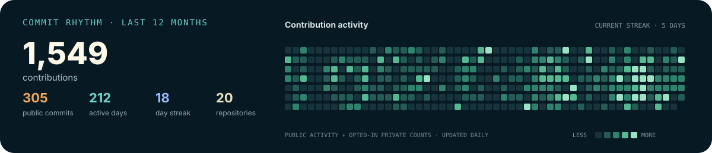

I build **data and AI systems** that turn messy information into useful products.

Currently working at **Zoox Smart Data** and a Data Science & AI graduate from UFPB. 

**[Portfolio](https://erlonl.github.io/)** &nbsp;·&nbsp; **[LinkedIn](https://www.linkedin.com/in/erlon-avelino/)** &nbsp;·&nbsp; **[Email](mailto:erlonlacerda1@gmail.com)**

 

