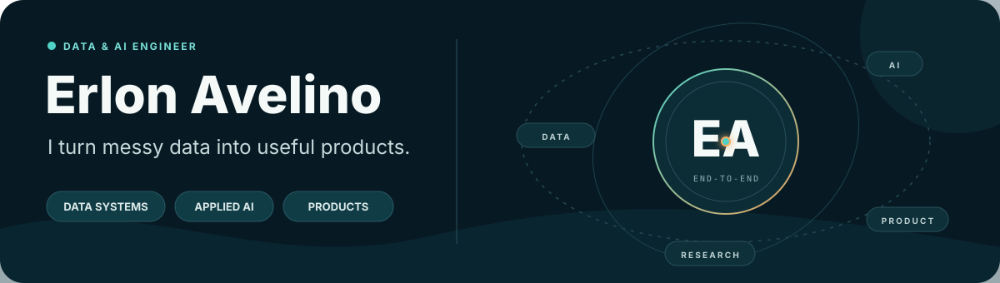
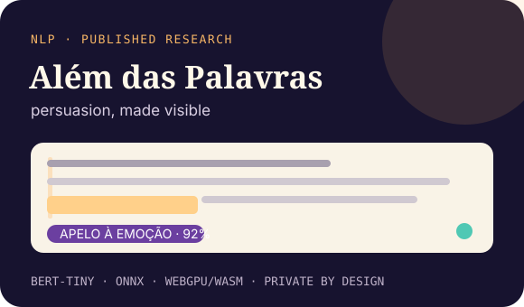
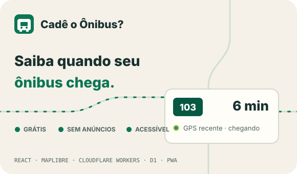
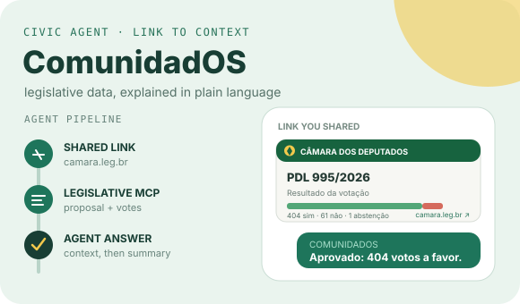
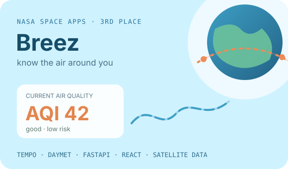
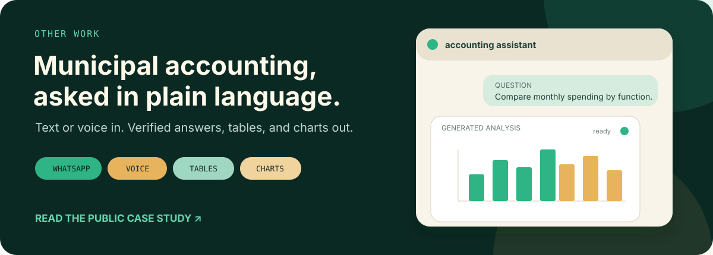
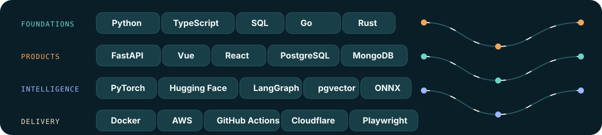

I build **data and AI systems** that turn messy information into useful products.

Currently working at **Zoox Smart Data** and a Data Science & Artificial Intelligence graduate from **UFPB**. I care about the whole path from raw data to a product someone can actually use: collection, modeling, APIs, interfaces, deployment, and the decisions that follow.

**[Portfolio](https://erlonl.github.io/)** &nbsp;·&nbsp; **[LinkedIn](https://www.linkedin.com/in/erlon-avelino/)** &nbsp;·&nbsp; **[Email](mailto:erlonlacerda1@gmail.com)**

 

 

**semantic lens** finds photos by memory instead of filename. The browser showcase uses Vue, TypeScript, Three.js, and a curated dataset; hybrid retrieval is on the roadmap. **[Try it](https://erlonl.github.io/photo-collection/)** · **[Source](https://github.com/erlonL/photo-collection)**

### Selected work

  
  

  
  

- **[Além das Palavras](https://erlonl.github.io/pln-demo/):** on-device BERT-Tiny research demo.
- **[Cadê o Ônibus?](https://erlonl.github.io/previsao-onibus/):** ad-free transit tracking on Cloudflare.
- **[ComunidadOS](https://github.com/erlonL/comunidados):** accessible civic information through WhatsApp text and voice.
- **[Breez](https://github.com/erlonL/Breez):** Space Apps podium project for local air-quality guidance.

### Other work

Client-tested agentic analytics over WhatsApp: text or voice questions become verified answers, tables, downloads, or charts. The implementation stays private. **[Read the case study](https://erlonl.github.io/projects/municipal-accounting-whatsapp-ai/)**.

### Research

I research **NLP, machine learning, and data products**. My published work includes *[Além das Palavras](https://sol.sbc.org.br/index.php/sbbd_estendido/article/view/44115/43878)*, alongside CO₂ clustering and studies of generative AI in education.

### What I build with

Data systems · applied AI · useful interfaces · build in public

